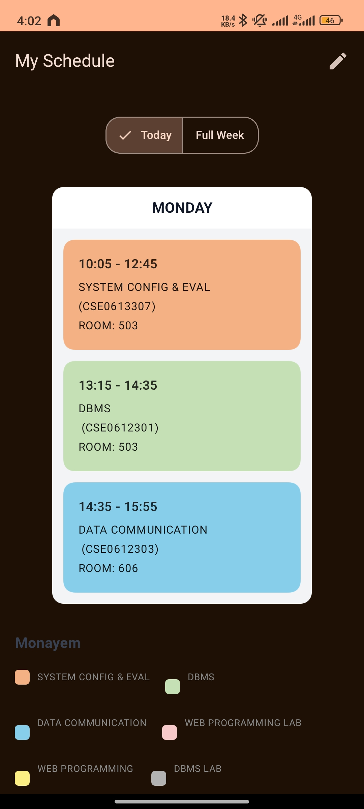
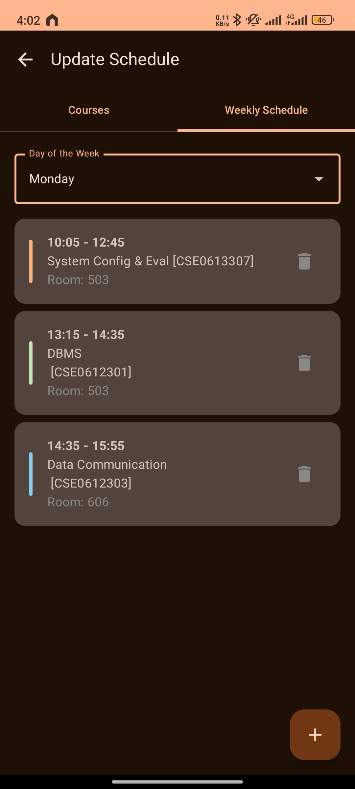
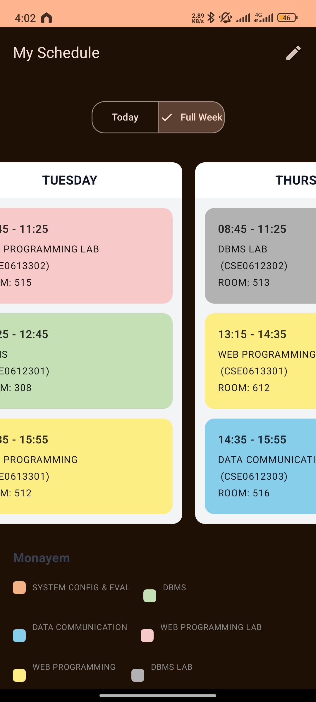

# Class Schedule App 🚀

[](https://opensource.org/licenses/MIT)
[](https://kotlinlang.org)
[](https://developer.android.com/jetpack/compose)

A modern, AI created, offline-first Android application designed to help students effortlessly manage their weekly class schedules. Built entirely with Jetpack Compose and the latest Android technologies, this app provides a clean, intuitive, and powerful tool for academic organization.

## ✨ Features

- **✍️ Full CRUD Functionality**: Easily **C**reate, **R**ead, **U**pdate, and **D**elete courses and class entries.
- **🎨 Color-Coded Courses**: Assign unique colors to each course for a vibrant and easy-to-read schedule.
- **🗓️ Dynamic Schedule Views**: Toggle between a focused **"Today"** view and a comprehensive **"Full Week"** overview of your timetable.
- **🔴 Live Class Indicator**: An "ON GOING" badge automatically highlights any class that is currently in session, so you never lose track of where you need to be.
- **🗄️ Robust Local Storage**: Powered by **Room Database**, all your schedule data is stored securely on your device, making it available offline, anytime.
- **📱 Modern UI/UX**: Built with **Material 3** and Jetpack Compose for a beautiful, responsive, and state-driven user experience.

## 📸 Screenshots

*(It is highly recommended to add screenshots or a GIF of your app in action to showcase its features visually.)*

| Main Screen (Today) | Update Schedule (Courses) | Full Schedule (Weekly View)  |
| :---: | :---: |:----------------------------:|
|  |  |  |


## 🛠️ Tech Stack & Architecture

This project leverages a modern, all-Kotlin technology stack and follows Google's recommended best practices for Android development.

- **Core**: [Kotlin](https://kotlinlang.org/)
- **UI**: [Jetpack Compose](https://developer.android.com/jetpack/compose) for a fully declarative and state-driven UI.
- **Styling**: [Material 3](https://m3.material.io/) for the latest design components and theming.
- **Architecture**: [MVVM (Model-View-ViewModel)](https://developer.android.com/jetpack/guide), using `ViewModel` from AndroidX to separate UI logic from business logic.
- **Database**: [Room](https://developer.android.com/training/data-storage/room) for robust, offline-first data persistence.
- **Asynchronicity**: [Kotlin Coroutines](https://kotlinlang.org/docs/coroutines-overview.html) for managing background threads and database operations.
- **Dependency Management**: [Gradle Kotlin DSL](https://docs.gradle.org/current/userguide/kotlin_dsl.html).

## 🚀 How to Build

To get a local copy up and running, follow these simple steps.

### Prerequisites

- Android Studio Iguana | 2023.2.1 or newer
- JDK 17

### Installation

1.  **Clone the repository**:
    ```sh
    https://github.com/freeloader3/Class-Schedule.git
    ```
2.  **Open in Android Studio**:
    Open the cloned project directly in Android Studio.

3.  **Sync & Run**:
    Allow Gradle to sync and download the necessary dependencies. Then, build and run the app on an emulator or a physical device.

## 🤝 Contributing

Contributions make the open-source community an amazing place to learn, inspire, and create. Any contributions you make are **greatly appreciated**.

If you have a suggestion that would make this better, please fork the repo and create a pull request. You can also simply open an issue with the tag "enhancement".

1.  Fork the Project
2.  Create your Feature Branch (`git checkout -b feature/AmazingFeature`)
3.  Commit your Changes (`git commit -m 'Add some AmazingFeature'`)
4.  Push to the Branch (`git push origin feature/AmazingFeature`)
5.  Open a Pull Request

## 📝 License

Distributed under the MIT License. See the `LICENSE` file for more information.
