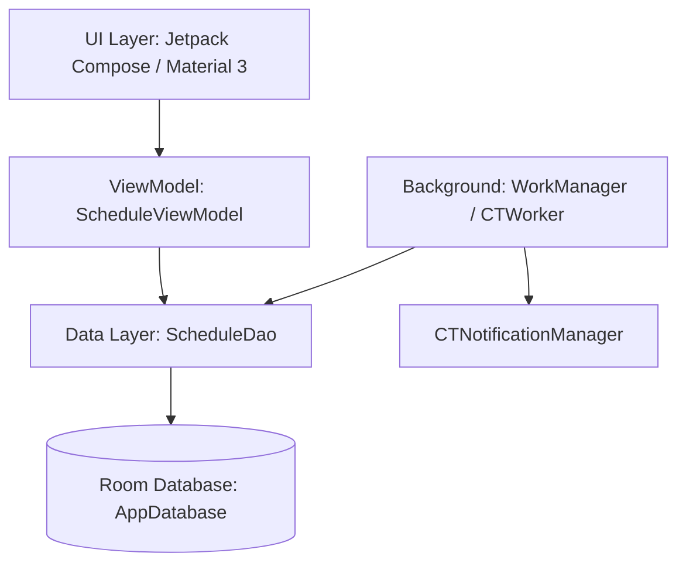

# Crono ⏱️ - Academic Schedule & Routine Manager

[](https://www.android.com)
[-brightgreen.svg?style=flat-square)](https://developer.android.com)
[-blue.svg?style=flat-square)](https://developer.android.com)
[](https://kotlinlang.org)
[](https://developer.android.com/jetpack/compose)
[](https://developer.android.com/training/data-storage/room)
[](LICENSE)

**Crono** is a modern, native Android application designed to help students seamlessly manage their
academic routines, weekly class schedules, upcoming exams, and class tests (CTs). Built using
**Jetpack Compose**, **Material 3**, **Room Database**, and **WorkManager**, Crono ensures students
stay organized and never miss a class or exam.

---

## 🌟 Key Features

- 📅 **Weekly Timetable & Schedule Management**:
    - Interactive daily routine view organized by day of the week.
    - Color-coded course cards displaying course code, instructor, room number, and time slot.
    - Quick toggle between compact and expanded schedule views.
    - Instant details modal for each subject and class entry.

- 📝 **Class Test (CT) & Exam Tracker**:
    - Track upcoming class tests and terminal exams.
    - Status management for class tests (pending vs. confirmed/completed).
    - Consolidated view of all scheduled assessments sorted chronologically.

- 🔔 **Smart Automated Background Notifications**:
    - Integrated with **WorkManager** (`CTWorker`) executing periodic checks every 15 minutes.
    - High-priority system notifications for upcoming class tests on test day.
    - Interactive confirmation notifications post-test to update test status.

- ⚠️ **Time Conflict Detection**:
    - Configurable schedule conflict preferences.
    - Highlights overlapping class schedules and conflicting time slots in real time.

- 🎨 **Dynamic UI & Font Customization**:
    - Built with **Material 3** dynamic themes and custom color palettes.
    - Dynamic font scaling controls via `FontSettingsManager`.
    - Android 12+ SplashScreen API integration (`SplashActivity`).

---

## 📸 Screenshots

| Daily Schedule View | Manage Courses & Routine | Class Tests & Exams | Settings & Customization |
|:-------------------:|:------------------------:|:-------------------:|:------------------------:|
| *(Add Screenshot)*  |    *(Add Screenshot)*    | *(Add Screenshot)*  |    *(Add Screenshot)*    |

---

## 🛠️ Architecture & Tech Stack

Crono follows modern Android development practices and the **MVVM (Model-View-ViewModel)**
architectural pattern with Kotlin Coroutines and Flow for reactive data streams.



### Core Technologies

- **Language**: [Kotlin](https://kotlinlang.org/) (2.2.10)
- **UI
  Framework**: [Jetpack Compose](https://developer.android.com/jetpack/compose) + [Material 3](https://m3.material.io/)
- **Database**: [Room Database](https://developer.android.com/training/data-storage/room) (2.8.5)
  with [KSP](https://kotlinlang.org/docs/ksp-overview.html) (2.3.6)
- **Background
  Tasks**: [Android WorkManager](https://developer.android.com/topic/libraries/architecture/workmanager)
  (2.9.0)
- **Asynchronous Flow**: Kotlin Coroutines & `StateFlow`
- **Build System**: Gradle (AGP 9.4.1) using Kotlin DSL & Version Catalogs (`libs.versions.toml`)

---

## 📁 Project Structure

```text
com.monayem.crono
├── CronoApp.kt                   # Application subclass initializing background workers
├── MainActivity.kt               # Main dashboard displaying weekly schedule & reminders
├── SecondActivity.kt             # Management hub for courses, schedules, exams & CTs
├── SplashActivity.kt             # Splash screen entry activity
├── CTWorker.kt                   # WorkManager CoroutineWorker for periodic CT checks
├── CTNotificationManager.kt      # Channel and notification builder for CT alerts
│
├── data/                         # Persistence layer (Room DB)
│   ├── AppDatabase.kt            # Room Database singleton
│   ├── ScheduleDao.kt            # Data Access Object for entities and queries
│   ├── Subject.kt                # Course/Subject Entity
│   ├── ScheduleEntry.kt          # Timetable Slot Entity
│   ├── ClassTestEntry.kt         # Class Test Entity
│   ├── ExamEntry.kt              # Exam Entry Entity
│   ├── ScheduleRelations.kt      # Relation data classes (1-to-many)
│   ├── ConflictPreferenceManager.kt # Preferences for schedule conflict rules
│   └── TimeUtils.kt              # Utility methods for date/time parsing & validation
│
└── ui/                           # UI Layer (Jetpack Compose)
    ├── schedule/
    │   ├── ScheduleViewModel.kt  # State holder for schedule & assessments
    │   └── EditSchedulePopup.kt  # Schedule entry dialog
    └── theme/
        ├── Color.kt              # App color palettes
        ├── FontSettings.kt       # Dynamic font sizing preferences
        ├── Theme.kt              # Material3 Theme configuration
        └── Type.kt               # Typography definition
```

---

## 🚀 Getting Started

### Prerequisites

- **Android Studio**: Koala / Ladybug or newer (2024.1+)
- **JDK**: JDK 17 or higher
- **Android SDK**: API Level 34 (Build Tools 34.0.0+)
- **Gradle**: 8.x+ (managed via Gradle Wrapper)

### Installation & Building

1. **Clone the repository**:
   ```bash
   git clone https://github.com/YOUR_USERNAME/Crono.git
   cd Crono
   ```

2. **Open in Android Studio**:
    - Open Android Studio and select **Open**.
    - Navigate to the cloned `Crono` project directory and click **OK**.

3. **Build the project**:
    - Sync Gradle project dependencies.
    - Build via command line:
      ```bash
      ./gradlew assembleDebug
      ```

4. **Run on Device / Emulator**:
    - Connect an Android device running API 24+ or launch an emulator.
    - Run the app via Android Studio or using Gradle:
      ```bash
      ./gradlew installDebug
      ```

---

## 🧪 Testing

Run unit tests locally using Gradle:

```bash
./gradlew test
```

Run instrumented UI tests on an attached device or emulator:

```bash
./gradlew connectedAndroidTest
```

---

## ⚙️ Configuration & Permissions

Crono requests the following Android permissions:

- `POST_NOTIFICATIONS` (Android 13+ / API 33+): Required for sending class test reminders and status
  confirmation notifications.

---

## 🤝 Contributing

Contributions are welcome and appreciated! If you would like to contribute:

1. **Fork the Repository**
2. **Create a Feature Branch**:
   ```bash
   git checkout -b feature/AmazingFeature
   ```
3. **Commit your changes**:
   ```bash
   git commit -m "Add AmazingFeature"
   ```
4. **Push to the branch**:
   ```bash
   git push origin feature/AmazingFeature
   ```
5. **Open a Pull Request**

---

## 📄 License

This project is licensed under the **MIT License**. See the [LICENSE](LICENSE) file for details.

---

## 👤 Author

Developed with ❤️ by **Monayem**.

- GitHub: [@YOUR_GITHUB_USERNAME](https://github.com/YOUR_GITHUB_USERNAME)
- Email: `your.email@example.com`

---

> *If you find Crono helpful, please consider giving this repository a ⭐️ on GitHub!*
